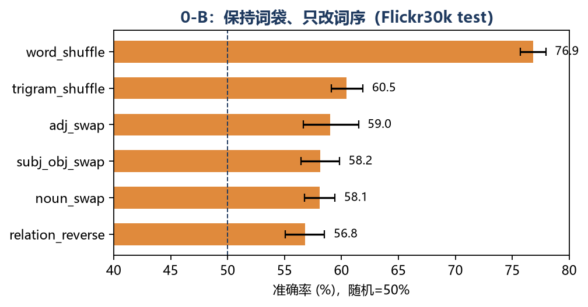
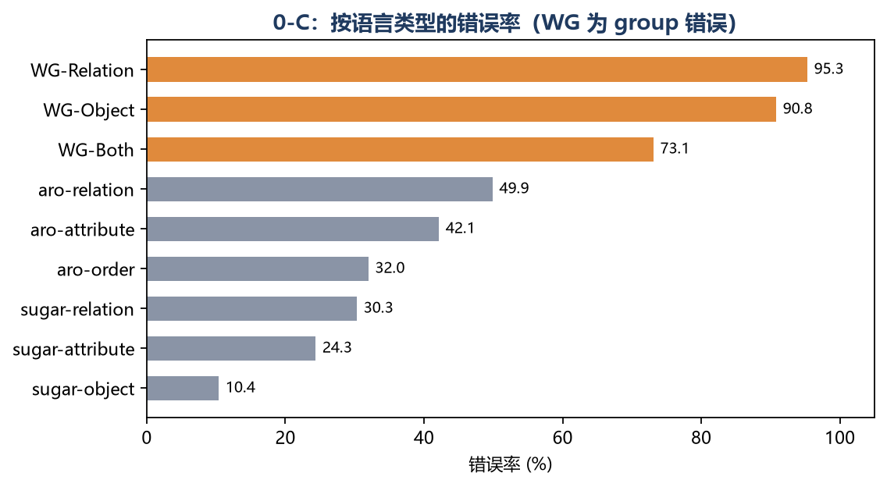
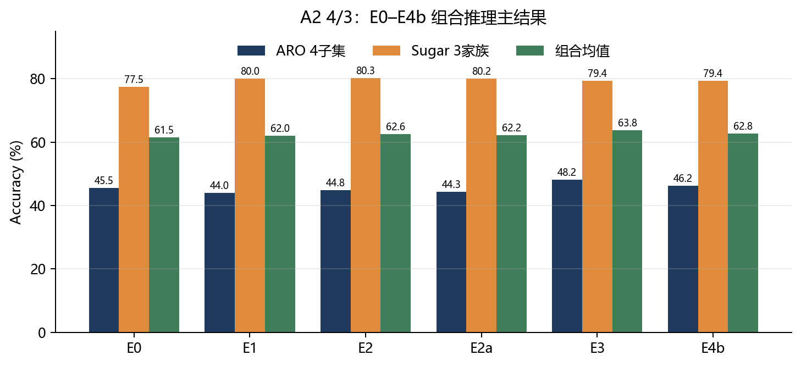
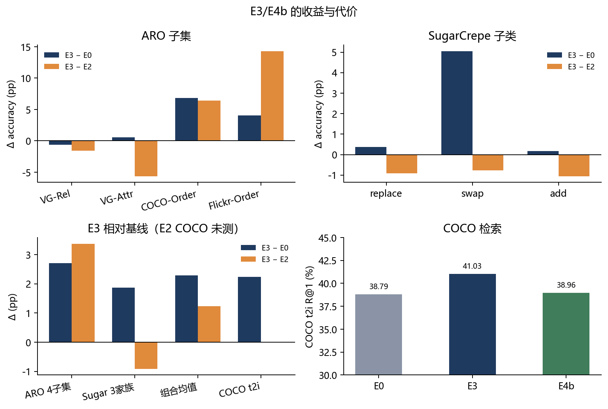

# 摘要

本项目研究 CLIP 类对比视觉语言模型的**组合推理盲区**，并尝试用硬负例微调、教师蒸馏和锁图像塔三种策略修复。诊断部分发现：CLIP 对“词袋相同、只改词序/关系”的负例非常敏感，0-B 探针中关系反转、主宾交换、名词/形容词交换的准确率只有 56%–59%；同时，Winoground 的线性探针 group 准确率可达 50.0%，说明组合信息并非完全不在表征中，而是零样本读数方式没有把它读出来。

修复部分比较了 E1（规则负例）、E2（LLM 负例）、E2a（过滤子集）、E3（复用 E2 负例 + 原始 CLIP 教师蒸馏）和 E4b（锁图像塔）。在 A2 4/3 全量协议（ARO 4 子集 + SugarCrepe 3 家族）上：

- E2 是 E1/E2/E2a 中的 E-best，selection score 62.5683%；
- E3 的 ARO 为 48.195%、Sugar 为 79.404%、组合均值为 **63.799%**；
- E3 相对 E0 的 ARO **+2.709pp**、Sugar **+1.865pp**、组合 **+2.287pp**，达到预注册 ≥2.0pp；COCO t2i 41.029% 相对 E0 38.794% **+2.235pp**，没有遗忘；
- 但 E3 的收益集中在 COCO-Order / Flickr-Order；VG-Relation / VG-Attribution 相对 E0 基本持平，相对 E2 明显下降；
- E4b 的 4/3 组合均值为 62.810%，与 E2 接近但没有稳定优势；检索 t2i/i2t 互有胜负。

因此，本项目得到的不是“全面提升组合推理”，而是更精确的结论：**在冻结的 A2 4/3 指标上，教师蒸馏达到了预注册的组合增益且不伤 COCO，但代价是 VG 关系/属性子集的退化；E4b 锁图像塔没有表现出稳定的组合优势。**

# 1 引言

## 1.1 问题

CLIP 在图文检索、零样本分类等任务上很强，但对“谁对谁做了什么”“属性属于谁”“短语顺序”这类组合结构仍然脆弱。一个典型例子：

```text
the dog is to the left of the cat
the cat is to the left of the dog
```

两句话词袋完全相同，只交换了主宾；CLIP 往往给两张图的分数非常接近。如果模型主要依赖“狗、猫、左”这些词，而不是真正绑定“谁在左”，就会出现组合盲区。

本项目要回答三个问题：

1. **诊断**：CLIP 到底对哪些组合变换敏感？信息是不在表征里，还是读数方式不对？
2. **修复**：硬负例微调、教师蒸馏、锁图像塔能否改善组合推理？
3. **代价**：组合能力提升是否以通用检索/COCO 能力为代价？

## 1.2 主要贡献

- 构造了 5 类保持词袋不变的 0-B 探针，量化 CLIP 对词序/关系/属性交换的敏感度；
- 用线性探针区分“信息不在”与“信息在但读不出”；
- 训练 E1/E2/E2a 三组硬负例模型，完成 E-best 选择；
- 实现 E3 教师蒸馏与 E4b 锁图像塔，补齐 E0–E4b 的 A2 4/3 + Flickr30k/Winoground 正式评测；
- 用配对 bootstrap + McNemar 给出组合增益与遗忘代价的统计证据；
- 提供可复现的 harness、`master.csv`、失败案例和 Gradio demo。

# 2 诊断：CLIP 的组合盲区

## 2.1 0-B：词序与关系敏感度

0-B 对每个 caption 做 5 类保持词袋不变的变换，另加 unrelated 对照。指标是“原句分数 > 变换句分数”的准确率，50% 是随机基线。

| 变换 | n | 准确率 | 95% CI | 平均 margin |
|---|---:|---:|---|---:|
| unrelated（对照） | 5,000 | 0.995 | [0.993, 0.997] | 0.228 |
| word_shuffle（全词打乱） | 4,998 | 0.769 | [0.757, 0.780] | 0.022 |
| trigram_shuffle（三元组内打乱） | 4,993 | 0.605 | [0.591, 0.619] | 0.007 |
| adj_swap（形容词交换） | 1,527 | 0.590 | [0.566, 0.615] | 0.004 |
| subj_obj_swap（主宾交换） | 3,472 | 0.582 | [0.565, 0.598] | 0.005 |
| noun_swap（名词交换） | 4,947 | 0.581 | [0.568, 0.594] | 0.004 |
| relation_reverse（关系反转） | 3,122 | 0.568 | [0.551, 0.585] | 0.003 |



结论：

- unrelated 99.5% 说明模型能区分“不同图的不同句子”，任务本身不难；
- 句法变换准确率只有 56%–61%，接近随机；
- margin 只有 0.003–0.007，远小于 unrelated 的 0.228，说明模型在“接近决策边界”的地方做判断，而不是真正理解关系。

## 2.2 0-A：信息在不在表征里

0-A 用 Winoground 构造二分类样本：正确绑定 vs 对调绑定；输入 `[g0,g1,t0,t1,g0*t0,g0*t1,g1*t0,g1*t1,|g0-g1|,|t0-t1|]`，做 5 折 GroupKFold 线性探针。

| 指标 | 数值 |
|---|---:|
| 零样本 text 准确率 | 0.352 |
| 零样本 image 准确率 | 0.113 |
| 零样本 group 准确率 | 0.077 |
| 线性探针 group 准确率 | **0.500** |
| 提升 | +0.422 |

线性探针达到 50.0%，显著高于零样本 7.7%。这说明**组合信息并非完全不在 CLIP 表征中**，至少有一部分可以被线性读出；零样本失败更像是“相似度读数方式”没有把关系信号放大。这为“轻量适配器/硬负例微调”提供了动机，但不能证明训练动力学。

## 2.3 0-C：E0 的错误模式

在 SugarCrepe++ 上，relation 类错误率 30.3%、attribute 24.3%、object 10.4%；relation 和 attribute 的错误中约 62%–69% 是“近失手”（margin 在 0.01 内）。Winoground 的 Relation 子集 group 只有 4.7%，且错误主要落在 image 侧（233 对中 62 对是 image 错、10 对是 text 错、150 对两者都错）。

| 基准/子集 | 主要失败类型 | 错误率 | 近失手占比 | 解释 |
|---|---|---:|---:|---|
| SugarCrepe relation | 关系反转 | 30.3% | 69.2% | 关系信号弱，边界偏移 |
| SugarCrepe attribute | 属性错位 | 24.3% | 62.1% | 属性绑定不稳 |
| SugarCrepe object | 对象替换 | 10.4% | 57.9% | 词袋捷径仍强 |
| ARO VG-Relation | 关系反转 | 49.9% | 58.0% | 接近随机 |
| ARO VG-Attribution | 属性错位 | 42.1% | 56.6% | 比 Sugar attribute 更难 |
| ARO Flickr-Order | 合成词序 | 32.0% | 57.4% | 词序敏感 |
| Winoground Relation | 双错 | 95.3% group 错 | — | 主要是 image 侧 |



# 3 方法

## 3.1 总体设计

保留 6 个主线实验组：

| 组 | 负例 | 损失 | 策略 | 目的 |
|---|---|---|---|---|
| E0 | — | — | 不微调 | 基线 |
| E1 | 规则法 | 硬负例 InfoNCE | 全量 FT | 负例来源① |
| E2 | LLM 法 | 同上 | 全量 FT | 负例来源② / E-best |
| E2a | LLM + 对抗过滤 | 同上 | 全量 FT | 过滤消融 |
| E3 | E2 负例 | + 原始 CLIP 教师蒸馏 λ=0.5 | 全量 FT | 抗遗忘 |
| E4b | E2 负例 | λ=0 | 锁图像塔 | 策略对比 |

E4a 直接复用 E2，不新增训练。

## 3.2 硬负例微调

- E1：规则法生成 1,158 条负例，去重/校验后 1,031 条、覆盖 915 张图（0.711%）；
- E2：LLM 生成 + 人工抽检 1,739 条（1.1993%）；
- E2a：E2 中按原 CLIP 图文相似度过滤出的 522 条子集（0.3600%）。

训练配置：ViT-B-32 / laion2b_s34b_b79k，4 epochs，batch 64 × accumulation 4（有效 256），AdamW lr 1e-5 / wd 0.1，cosine warmup 200，AMP，seed 42。E1/E2/E2a 为全量微调；E3 同样从原始 CLIP 独立初始化，做全量微调并加原始 CLIP 教师蒸馏；E4b 锁图像塔。

## 3.3 E3：教师蒸馏

E3 **复用 E2 的负例集合，但学生模型从原始 CLIP（`laion2b_s34b_b79k`）独立初始化，不从 E2 初始化**；教师是**冻结的原始 CLIP**，不是 E2。损失为硬负例 InfoNCE + λ=0.5 的 KL 蒸馏项（教师温度 T=2，教师缓存为 Flickr30k train 的原始 CLIP 特征）。目标是保留 E2 负例带来的组合信号，同时用原始 CLIP 作为锚点减少对通用检索/COCO 的遗忘。预注册标准：

- E3 相对 E0 的组合指标 ≥ +2.0pp；
- COCO R@1 下降 ≤1.0pp；
- E3 相对 E-best 组合指标下降 ≤0.5pp，且 COCO 遗忘更小。

## 3.4 E4b：锁图像塔

E4b 冻结图像塔，只训练文本侧，用 E2 的硬负例，λ=0。假设是：组合失败主要来自文本侧/相似度读数，锁图像塔可以降低训练成本并减少图像表征遗忘。

# 4 实验设置

## 4.1 数据

| 数据 | 规模 | 用途 |
|---|---|---|
| Flickr30k train | 29,000 图 / 145,000 caption | 训练与负例源 |
| Flickr30k val | 1,014 图 / 5,070 caption | 300 图训练监控（非正式） |
| Flickr30k test | 1,000 图 / 5,000 caption | 检索、ARO Flickr-Order |
| ARO | 82,695 查询（VG-Rel / VG-Att / COCO-Order / Flickr-Order） | 组合评测 |
| 原版 SugarCrepe | 7,511 查询（replace / swap / add） | 组合评测 |
| COCO val2017 | 5,000 图 / 25,014 caption | 通用检索/遗忘 |

## 4.2 两套评测口径

- **共同 2/2**：ARO 只用 `vg_relation`、`vg_attribution`；Sugar 只用 `replace`、`swap`。六个模型都有，用于与早期 E0 归档对齐。
- **A2 4/3**：ARO 四个子集、Sugar 三个家族，对应 B 的冻结选模协议；E0 也在同一协议上重跑，因此 E3-vs-E0 是严格配对比较。

E0 的早期 A1 归档为 ARO 53.987 / Sugar 74.314（A1 原图协议），A2 4/3 重跑为 ARO 54.416 / Sugar 73.897（VG-crop 协议）；主表使用 A2 版本，旧值只作历史对照。两套口径不能混算。

## 4.3 统计

- 配对 bootstrap 1000 次，95% 百分位 CI；
- 二选一子集用 McNemar 检验；
- 检索：Flickr30k 1,000 图 / 5,000 caption，COCO 5,000 图 / 25,014 caption，Winoground 400 对；
- 所有正式运行在 Colab Enterprise Tesla T4 上完成；E0 941.4s，E3 937.1s，E4b 939.1s。

# 5 结果

## 5.1 共同 2/2

| 模型 | ARO macro | SugarCrepe macro | 说明 |
|---|---:|---:|---|
| E0 | 54.416% | 73.897% | A2 4/3 重跑的原始 CLIP |
| E1 | 57.649% | 77.114% | 规则负例，全量 FT |
| E2 | 58.016% | 77.443% | LLM 负例，全量 FT；E-best / E4a |
| E2a | 57.434% | 77.066% | 过滤子集 |
| E3 | 54.398% | 76.604% | E2 负例 + 原始 CLIP 蒸馏 λ=0.5 |
| E4b | 57.566% | 76.358% | E2 + 锁图像塔 |

E1/E2/E2a 的 ARO 比 E0 高 3.0–3.6pp、Sugar 高 3.2–3.5pp；E2 仍是三者中最高。E3 的 ARO 与 E0 基本持平（−0.018pp），Sugar 高 +2.707pp；E4b 的 ARO 高 3.150pp、Sugar 高 2.461pp。E3/E4b 的 ARO 都低于 E2（分别 −3.618 / −0.450pp），Sugar 也低于 E2（−0.839 / −1.085pp）。

## 5.2 A2 4/3 全量

| 模型 | ARO 4子集 | Sugar 3家族 | 组合均值 | COCO t2i | COCO i2t |
|---|---:|---:|---:|---:|---:|
| E0 | 45.486% | 77.539% | 61.512% | 38.794% | 56.580% |
| E1 | 43.974% | 80.046% | 62.010% | — | — |
| E2 | 44.823% | 80.314% | 62.568% | — | — |
| E2a | 44.289% | 80.160% | 62.224% | — | — |
| E3 | 48.195% | 79.404% | **63.799%** | 41.029% | 59.120% |
| E4b | 46.235% | 79.385% | 62.810% | 38.958% | 58.000% |



关键观察：

- E0 的 Flickr-Order 为 40.680%，高于 E1/E2/E2a 的 29.5–30.4%，所以 E0 的 4/3 ARO macro 反而高于这三者；E1/E2/E2a 的 4/3 组合优势主要来自 Sugar。
- E3 的 4/3 提升主要来自 COCO-Order（32.431→39.244）和 Flickr-Order（40.680→44.740）；VG-Relation（50.077→49.463）和 VG-Attribution（58.755→59.333）相对 E0 基本持平。
- E4b 的 order 子集也高于 E2，但 VG 两个子集略低；4/3 组合均值只比 E2 高 0.242pp。

## 5.3 E3 预注册核对

| 指标 | E0 | E3 | E3 − E0 |
|---|---:|---:|---:|
| ARO 4子集 | 45.486% | 48.195% | +2.709pp |
| Sugar 3家族 | 77.539% | 79.404% | +1.865pp |
| 组合均值 | 61.512% | 63.799% | **+2.287pp** |
| COCO t2i | 38.794% | 41.029% | +2.235pp |

全量配对：

- E3 − E0 ARO：+2.709pp，95% CI [+2.372, +3.040]；
- E3 − E0 Sugar：+1.865pp，95% CI [+1.020, +2.663]；
- 共同 2/2：E3 − E0 ARO −0.018pp（CI [−0.336, +0.293]），Sugar +2.707pp（CI [+1.450, +3.911]）。

预注册主标准在 4/3 上成立（组合 +2.287 ≥2.0，COCO 不降反升）；E3 vs E-best 组合 +1.231pp，也不下降。但“COCO 遗忘比 E-best 更小”因 E2 没有同批次 COCO 而未验证。



## 5.4 E4b

E4b 的 4/3 组合均值 62.810%，相对 E2 +0.242pp、相对 E0 +1.298pp；ARO 相对 E2 +1.412pp、Sugar −0.929pp。共同 2/2 上 E4b 相对 E2 为 ARO −0.450pp、Sugar −1.085pp；Flickr30k t2i 71.44%（比 E2 低 1.54pp），i2t 88.50%（比 E2 高 1.00pp），Winoground group 7.75% vs 8.00%（差异在噪声内）。

因此 E4b 的定位是“4/3 组合均值与 E2 接近、检索互有胜负”，没有足够证据宣称锁图像塔更优。

## 5.5 检索与 Winoground

| 模型 | Flickr30k t2i | Flickr30k i2t | Winoground group | COCO t2i |
|---|---:|---:|---:|---:|
| E0 | 66.76% | 84.20% | 7.75% | 38.794% |
| E1 | 73.98% | 87.10% | 8.25% | — |
| E2 | 72.98% | 87.50% | 8.00% | — |
| E2a | 73.68% | 87.50% | 8.25% | — |
| E3 | 73.26% | 85.70% | 7.50% | 41.029% |
| E4b | 71.44% | 88.50% | 7.75% | 38.958% |

Winoground group 全部在 7.50%–8.25% 之间，400 对的 95% CI 约 ±3–4pp，不能据此宣称任何一组更好。E3 的 COCO t2i 比 E0 高 2.235pp，没有遗忘。

# 6 失败分析

从 E3 的 A2 正式逐样本结果中取 30 条错误案例：ARO 15 条（4 个子集分层）+ SugarCrepe 15 条（replace/swap/add 各 5 条），按 positive − best negative margin 最小选取。

主要模式：

- ARO relation：关系方向反转，如 “the cat is behind the wheel” vs “the wheel is behind the cat”；
- ARO attribution：属性绑定错位，如 “white tail / concrete ground” 被换成 “concrete tail / white ground”；
- ARO order：COCO/Flickr 的短语顺序被打乱后仍被判为更匹配；
- SugarCrepe：replace 的近义/关系替换、swap 的对象/属性互换、add 的额外对象插入。

这 30 条是最接近决策边界的错误，不是错误比例估计。它们与 0-C 的诊断一致：模型仍依赖表面词序和显著对象，而不是稳定的关系/属性结构。完整案例见 `report/results/failure_cases.md`。

# 7 讨论

## 7.1 为什么 E3 在 4/3 成功、在 2/2 不成功

E3 的收益几乎全部来自 order 子集：COCO-Order +6.813pp、Flickr-Order +4.060pp（相对 E0）；VG-Relation −0.614pp、VG-Attribution +0.577pp。因此：

- 在 4/3 上，order 子集的权重大，E3 的组合均值 +2.287pp，预注册标准成立；
- 在 2/2 上，只剩 VG 两子集，E3 与 E0 基本持平（−0.018pp），相对 E2 则明显下降（−3.618pp）。

这不是统计矛盾，而是**口径决定的结论**。报告必须同时给出两套表，不能只报有利的一套。

## 7.2 E4b 的定位

E4b 锁图像塔后，4/3 组合均值与 E2 接近（+0.242pp），但共同 2/2 和检索没有稳定优势。它更像一个“成本更低的近似方案”，而不是“更好的组合模型”。训练显存/时间优势只能作为工程侧证据，不能替代 benchmark。

## 7.3 与 B 的选模口径

B 的 E-best 使用 4/3 的 ARO+Sugar 平均，E2 以 62.5683% 胜出。本项目的 4/3 表复现了该分数（62.568%），说明评测口径一致。E3/E4b 是 E2 之后的蒸馏/锁塔策略，不参与 E-best 选择；报告没有把 E3 的 4/3 结果倒推成“E3 应该替代 E2”。

# 8 结论与局限

## 8.1 结论

1. CLIP 的组合盲区主要体现在关系/属性绑定和词序，而不是“完全没有任何组合信息”；线性探针能从同一表征中读出 50% 的 Winoground group。
2. 硬负例微调（E1/E2/E2a）在共同 2/2 上稳定高于 E0；E2 是 E-best。
3. E3 在 A2 4/3 上达到预注册主标准：组合 +2.287pp、COCO +2.235pp，ARO/Sugar 全量配对 CI 都排除 0。
4. 但 E3 的收益集中在 order 子集；VG-Relation/VG-Attribution 相对 E0 基本持平、相对 E2 明显下降。不能宣称“全面提升组合推理”。
5. E4b 与 E2 接近但没有稳定优势；锁图像塔不是免费的组合增益。
6. 主要缺口：E2/E1/E2a 的同批次 COCO、官方 Flickr30k/Winoground 复核、第二训练 seed。

## 8.2 局限

- 单训练 seed；无第二 seed，不能宣称稳定性。
- 共同 2/2 与 A2 4/3 是两套口径；E3 在 2/2 的 VG 子集与 E0 持平，在 4/3 因 order 子集胜出。
- E0 有 A1 归档和 A2 4/3 两个版本；主表用 A2 版本，旧值只作历史对照。
- E4b 的 Sugar 在 A2 4/3 与旧 `evals-mm` 2 家族之间差 0.439pp；主表统一采用 A2。
- E2 没有同批次 COCO，无法验证“E3 的 COCO 遗忘比 E-best 更小”。
- Winoground 只有 400 对，统计功效有限；Flickr30k/Winoground 使用公开镜像，官方数据复核未完成。
- E2a 是 522 条过滤子集，与 E2 的 1,739 条不匹配；E1/E2 同时改变负例来源与覆盖量。

## 8.3 展望

- 补 E2/E1/E2a 的 COCO 4/3 评测，形成完整 6 模型 COCO 表；
- 补第二个训练 seed、matched-size 负例对照和更多基座（ViT-B/16、SigLIP）；
- 用官方 Flickr30k/Winoground 数据复核，并补 ARO COCO-Order / SugarCrepe add 的独立分析；
- 针对 E3 的“order 收益、VG 代价”做消融：蒸馏温度、order 子集采样比例、VG 数据权重；
- 把 E-best 封装为 `ImageTextEncoder` 服务，接入 Mnemo 的图像记忆检索。

# 附录 A 复现与交付

```bash
# 环境
pip install -r requirements.txt
python -m spacy download en_core_web_sm

# E0–E4b A2 4/3（GPU）
python scripts/evaluate_role3_models.py --tags e0 e3 e4b \
  --benchmarks aro sugarcrepe coco --device cuda --image-batch 64 --text-batch 256

# 检索（E1–E4b）
for tag in e1 e2 e2a e3 e4b; do
  python evals-mm/run_eval.py --tag "$tag" \
    --checkpoint "A2_models/$tag/${tag}_model.pt" --benchmark flickr30k
  python evals-mm/run_eval.py --tag "$tag" \
    --checkpoint "A2_models/$tag/${tag}_model.pt" --benchmark winoground
done

# 汇总、图、报告
python scripts/assemble_role3_results.py
python scripts/build_full_4of3.py
python scripts/build_full_master.py
python scripts/paired_full_4of3.py
python scripts/make_failure_cases_a2.py
python scripts/make_master_md.py
python scripts/make_role3_figures.py
python scripts/make_results_table.py
python scripts/build_report.py
python scripts/build_role3_ppt.py
```

主要交付物：

| 文件 | 内容 |
|---|---|
| `report/06_method.md` / `07_conclusion.md` | 详细方法与结论 |
| `report/results/full_4of3.*` | A2 4/3 六模型结果 |
| `report/results/paired_full_4of3.*` | 全量配对统计 |
| `report/results/failure_cases.md` | 30 条失败案例 |
| `report/CompoCLIP_Report.docx` / `.pdf` | 完整报告 |
| `report/CompoCLIP_成员3汇报.pptx` | 角色 3 答辩 PPT |
| `demo/app.py` / `demo/README.md` | Gradio demo |
| `docs/role3_delivery.md` | 交付清单 |
