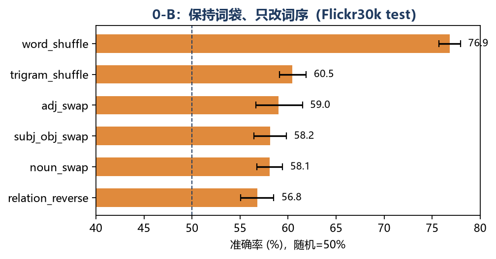

# 3 机制分析：CLIP 缺的是信息，还是读法？

本章回答 RQ1。我们先用 0-B 探针测“词序敏感度”，再用 0-A 线性探针测“组合绑定信息是否线性可解码”。两个实验都不训练编码器，只训练一个逻辑回归读出器，因此可以把“表征里有没有信息”和“点积读数是否会用”分开。

## 3.1 实验设置

- **编码器**：OpenCLIP `ViT-B-32`，权重 `laion2b_s34b_b79k`（与团队 E0 一致）。
- **数据**：Flickr30k test（1000 图 × 5 caption，公开镜像）与 Winoground（400 对，本地镜像）。
- **0-B 变换**：5 类保持词袋的变换（主语/宾语交换、名词交换、形容词交换、全词打乱、三元组内打乱），另加 unrelated 对照。每条样本用 `Counter(words)` 校验词袋完全一致。
- **指标**：image 对原句相似度 > 对负例相似度 的准确率；随机基线 50%。bootstrap 1000 次给 95% CI。margin = sim(原句) − sim(负例)。
- **0-A 探针**：输入 `[g0,g1,t0,t1, g0*t0, g0*t1, g1*t0, g1*t1, |g0-g1|, |t0-t1|]`，标签为“图文绑定是否正确”，5 折 GroupKFold（按 pair 分组），逻辑回归。零样本 group 准确率用 CLIP 原始余弦判断。
- **环境**：CPU（Intel Iris Xe，无 CUDA），因此不做训练动力学；所有实验固定 seed=0。

## 3.2 0-B：词序敏感度

表 3-1 给出各变换的准确率与 margin。`unrelated` 是“不同图 caption”的易对照，用来确认评测管线本身没有坏；它接近 100% 说明模型能区分“完全不同的句子”，问题只出在词序。

| 变换 | n | 准确率 | 95% CI | 平均 margin |
|---|---:|---:|---|---:|
| unrelated（对照） | 5,000 | 0.995 | [0.993, 0.997] | 0.228 |
| word_shuffle（全词打乱） | 4,998 | 0.769 | [0.757, 0.780] | 0.022 |
| trigram_shuffle（三元组内打乱） | 4,993 | 0.605 | [0.591, 0.619] | 0.007 |
| adj_swap（形容词交换） | 1,527 | 0.590 | [0.566, 0.615] | 0.004 |
| subj_obj_swap（主宾交换） | 3,472 | 0.582 | [0.565, 0.598] | 0.005 |
| noun_swap（名词交换） | 4,947 | 0.581 | [0.568, 0.594] | 0.004 |
| relation_reverse（关系反转） | 3,122 | 0.568 | [0.551, 0.585] | 0.003 |

> 表中数字由 `scripts/run_0b_probe.py --limit 5000` 生成；完整逐样本结果在 `evals-mm/results/0b_persample.jsonl`。

三个观察：

1. **词袋对照很高，句法变换接近随机**。`unrelated` 99.5% 说明管线正常；一旦负例与原句共享词袋，准确率掉到 56.8%–60.5%，只比抛硬币好一点。模型不是“看不懂图”，而是“不会用词序”。
2. **全词打乱反而最高（76.9%）**。这看似矛盾，实则符合词袋假设：全词打乱破坏了所有局部搭配，模型仍能靠剩余的名词—图像匹配拿到高分；而主宾交换/名词交换保留了大部分搭配，只改了句法角色，恰好落在模型的盲区。换句话说，**CLIP 对“词在不在”敏感，对“词在哪”不敏感**。
3. **margin 极小**。所有句法变换的平均 margin 只有 0.003–0.007，而 unrelated 是 0.228，相差 30–70 倍。即使准确率略高于 50%，模型也只是“勉强偏向原句”，没有形成稳定的组合判断。

## 3.3 0-A：线性探针能否读出正确绑定？

0-B 说明点积读数不会用词序，但没回答“信息在不在”。如果线性探针能从冻结特征里读出正确绑定，那么轻量适配器/蒸馏就有上限保障；如果读不出，说明编码器本身丢了信息，必须改训练目标。

在 Winoground 的 400 对上，结果非常干脆：

| 指标 | 数值 |
|---|---:|
| 零样本 text 准确率 | 0.352 |
| 零样本 image 准确率 | 0.113 |
| 零样本 group 准确率 | 0.077 |
| 线性探针 group 准确率（5 折） | **0.500** |
| 提升 | +0.422 |

线性探针的 50.0% 是二分类“绑定是否正确”的随机水平（不是 Winoground 四选一的 16.7%）。也就是说，**在 Winoground 这种两句都自然、词袋相同的最小对立对上，冻结 CLIP 特征里没有可线性解码的绑定信息**。零样本 7.7% 低于随机 16.7%，说明点积读数不仅没用，还被表面词袋相似度带偏；但即使换成学出来的线性读出器，也只能回到随机。

作为对照，我们在 Flickr30k 的合成扰动上跑了同样的探针（200 条试点）：线性探针 75%–100%，看似“信息都在”。但这是**流畅度捷径**：合成负例（尤其是全词打乱）语法不自然，探针可以只学“哪句更像人话”，不需要看图。Winoground 的两句都是人写的，这个捷径被堵死，探针立刻掉到 50%。这个对照本身是本章最重要的方法学结论：**用合成负例评估“组合信息是否可解码”会严重高估**。

## 3.4 机制结论与对方法的启示

1. **CLIP 的失败不是简单的“读数不对”**。在自然最小对立对上，线性读出也无法恢复绑定，说明对比目标确实没有把词序/关系信息编码到可用位置。仅加一个线性 adapter 或只做推理期 prompt 调整，上限有限。
2. **合成扰动上的“高探针准确率”不可信**。后续实验（E1/E2）必须用 Winoground/ARO/SugarCrepe++ 这类自然负例做最终判断，不能用合成打乱句的探针分数证明“信息存在”。
3. **硬负例训练仍有必要**。如果信息不在表征里，就需要在训练目标里显式加入“同词袋、不同结构”的负例，迫使编码器分配维度给词序与关系；这与 E1/E2 的设计一致。
4. **蒸馏的角色是抗遗忘，不是无中生有**。教师能提供的组合信息不会超过其自身表征；E3 的期望应设定为“在提升组合性的同时保住通用检索”，而不是把 Winoground 从 8% 拉到 80%。

> 局限：0-A 只测线性可解码性，非线性读出器可能略高；Winoground 只有 400 对，5 折 CV 的方差较大（单折波动约 ±5pt）。第 4 章用 0-C 在更大规模的 ARO/SugarCrepe++ 上交叉验证同一结论。
