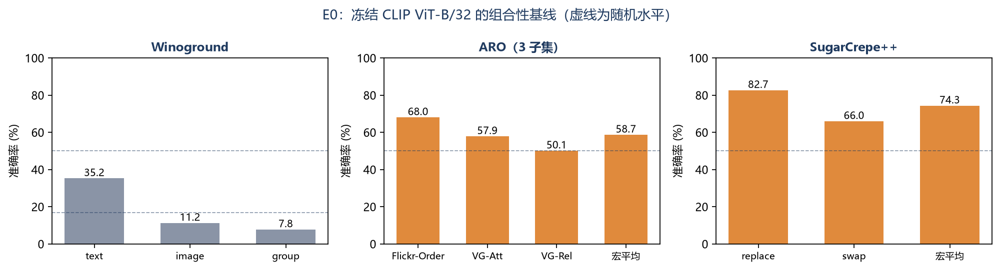
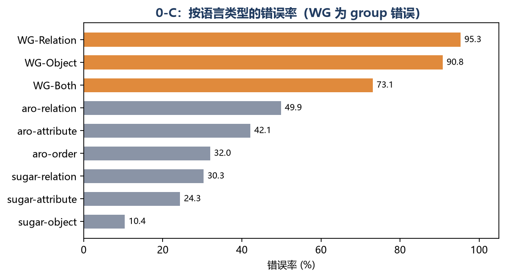
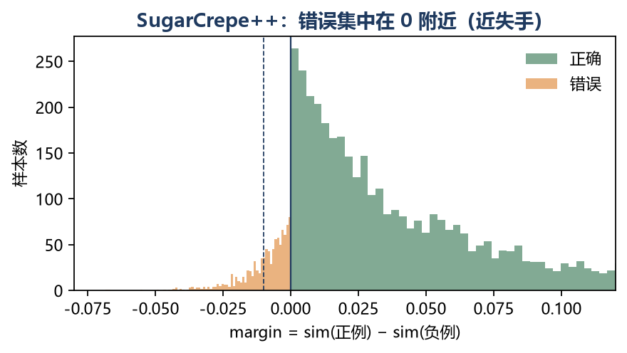

# 4 E0 基线与失败诊断

本章回答 RQ2：在不做任何微调的 CLIP 上，组合性失败到底长什么样？我们先用统一协议跑 E0，再用 0-C 把逐样本错误按语言类型分桶，区分“完全不会”和“差一点”。

## 4.1 实验设置

- **模型**：OpenCLIP `ViT-B-32` / `laion2b_s34b_b79k`，冻结，零样本。
- **基准**：
  - Winoground（400 对，text/image/group 三项）；
  - ARO：VG-Relation（23,937 对）、VG-Attribution（28,748 对）、Flickr-Order（18,994 对，用 ARO 官方 4 种扰动在 Flickr30k test 上重建）；COCO-Order 因缺 COCO test2014 原图暂缺（见 decision-log D0-5）；
  - SugarCrepe++（4,757 条：replace 3,846、swap 911；镜像未含 add 子类）。
- **指标**：二选一准确率（正例得分 > 负例），bootstrap 1000 次 95% CI；ARO 同时给子集准确率与宏平均（子集等权）。
- **逐样本**：`evals-mm/results/e0_{bench}_persample.npz` 保存每条的 pos/neg 分数、subset、correct，0-C 直接读取，避免手抄。
- **数据说明**：Flickr30k/Winoground 使用公开镜像，ARO 使用官方 gdown 标注 + VG 图片；正式提交前需用官方数据复核，差异写入脚注。

## 4.2 E0 主结果

### 4.2.1 Winoground

| 指标 | 准确率 | 95% CI |
|---|---:|---|
| text | 0.352 | [0.308, 0.403] |
| image | 0.113 | [0.083, 0.143] |
| group | 0.077 | [0.053, 0.103] |

group 7.7% 远低于四选一随机基线 16.7%。值得注意的是 **image 指标（11.3%）远低于 text（35.2%）**：给定 caption 选图时，模型几乎无法区分两张只差关系/属性的图；反过来给定图选 caption 时，至少还能靠词袋匹配拿到三分之一。这与“文本编码器保留了更多表面线索、图像侧绑定更弱”的解释一致。

### 4.2.2 ARO

| 子集 | n | 准确率 | 95% CI |
|---|---:|---:|---|
| VG-Relation | 23,937 | 0.501 | [0.494, 0.508] |
| VG-Attribution | 28,748 | 0.579 | [0.573, 0.584] |
| Flickr-Order | 18,994 | 0.680 | [0.674, 0.687] |
| **宏平均（3 子集）** | — | **0.587** | — |

结果与直觉相反：**VG-Relation 50.1%，几乎就是随机**；VG-Attribution 57.9%；Flickr-Order 反而最高（68.0%）。这并不意味着模型“会词序”，而是因为 Flickr-Order 是**合成扰动**：名词/形容词打乱后句子常常不合语法，模型可以靠“哪句更像人话”判断，不需要真正理解词序。这与 0-A 的结论一致——合成负例上的高分可能是流畅度捷径。官方 ARO 的 Order 子集是五选一排序，且正负句都经过筛选，不能把这里的 68.0% 与论文表格直接比较。

VG-Relation 的 50.1% 是最干净的信号：关系方向（左/右、上/下、前/后）在词袋上几乎相同，模型完全没有可用线索。这与 SugarCrepe++ relation 的 30.3% 错误率、Winoground Relation 的 4.7% group 准确率形成同一条证据链。

> COCO-Order 未跑：需要 COCO test2014 原图（约 6GB），当前数据未提供。为避免把 3 子集宏平均冒充官方 4 子集，表中明确标注“3 子集”。

### 4.2.3 SugarCrepe++

| 子类 | n | 准确率 | 95% CI |
|---|---:|---:|---|
| replace | 3,846 | 0.827 | [0.815, 0.839] |
| swap | 911 | 0.660 | [0.630, 0.687] |
| all（微平均） | 4,757 | 0.795 | [0.783, 0.806] |
| **macro（replace/swap 等权）** | — | **0.743** | — |

replace 82.7% 说明“换一个词”模型还能察觉；swap 只有 66.0%，一旦要求保持词袋、只换结构，准确率立刻掉 17 个百分点。这与 0-B 的结论完全一致，也说明 SugarCrepe++ 的 swap 子类是比 replace 更纯的组合性测试。

## 4.3 0-C 失败模式分类

0-C 的规则是显式、可审计的：先看子集名（order/att/rel/obj/add），再看正负句词袋是否完全相同（相同则归 order），最后落到 other。每条错误都保留原句、负例、margin，典型样本见 `evals-mm/results/0c_examples.md`。

### 4.3.1 SugarCrepe++：关系错误最多，且多为“近失手”

| 类型 | n | 错误率 | 平均 margin | 近失手占错误比例 | 自信错误占比 |
|---|---:|---:|---:|---:|---:|
| relation | 1,406 | 30.3% | 0.013 | 69.2% | 0.5% |
| attribute | 1,454 | 24.3% | 0.019 | 62.1% | 0.0% |
| object | 1,897 | 10.4% | 0.058 | 57.9% | 0.5% |

三个现象：

1. **relation 最难**（30.3% 错误），且 69.2% 的错误 margin 落在 (−0.01, 0] 的“近失手”区间；真正“自信地错”（margin < −0.05）不到 1%。这说明模型不是完全没信号，而是**决策边界偏了**：正负分数差在千分位，稍微校准/重读数就可能翻盘。
2. **object 最易**（10.4%），平均 margin 0.058，是 relation 的 4.5 倍。名词替换带来的词袋差异最大，模型最容易抓。
3. **attribute 居中**（24.3%），但近失手比例 62.1%，说明形容词—名词绑定也不稳。

这解释了为什么“只加一个线性 adapter”可能对 SugarCrepe++ 有效（近失手多），但对 Winoground 不够（见 4.3.2）。

### 4.3.2 Winoground：关系类几乎全错，且图像侧更差

| collapsed tag | n | text | image | group | 仅 text 错 | 仅 image 错 | 两者都错 |
|---|---:|---:|---:|---:|---:|---:|---:|
| Relation | 233 | 0.313 | 0.090 | 0.047 | 10 | 62 | 150 |
| Object | 141 | 0.390 | 0.113 | 0.092 | 3 | 42 | 83 |
| Both | 26 | 0.500 | 0.308 | 0.269 | 1 | 6 | 12 |

Relation 类的 group 只有 4.7%，233 对里 150 对“图文两边都错”。更细的分解显示：**仅 image 错（62）远多于仅 text 错（10）**，即模型给图选 caption 时还能靠词袋，给 caption 选图时几乎失效。Object 类稍好（group 9.2%），但仍远低于随机基线。Winoground 的失败不是“某一侧偶然错”，而是**双向绑定整体缺失**，这与 0-A 线性探针 50% 的结果互相印证。

### 4.3.3 跨基准对比

| 基准/子集 | 主要失败类型 | 错误率 | 近失手比例 | 解释 |
|---|---|---:|---:|---|
| SugarCrepe++ relation | 关系方向 | 30.3% | 69.2% | 有信号但边界偏，校准可能有效 |
| SugarCrepe++ attribute | 属性绑定 | 24.3% | 62.1% | 局部搭配尚可，绑定不稳 |
| SugarCrepe++ object | 名词替换 | 10.4% | 57.9% | 词袋差异大，最易 |
| ARO VG-Relation | 关系方向 | 49.9% | 58.0% | 接近随机，最干净的“无信号”证据 |
| ARO VG-Attribution | 属性绑定 | 42.1% | 56.6% | 比 SugarCrepe attribute 更难（VG 更复杂） |
| ARO Flickr-Order | 合成词序 | 32.0% | 57.4% | 数字偏高，含流畅度捷径，不直接可比 |
| Winoground Relation | 双向绑定 | 95.3% group 错 | — | 自然最小对立对，无表面捷径 |

> ARO 的近失手比例由 `0c_taxonomy.csv` 自动计算；本表在 ARO 评测完成后回填。

## 4.4 失败深度：近失手 vs 自信错误

“近失手”比例是本项目方法选择的关键依据。SugarCrepe++ 上 58%–69% 的错误 margin 在 0.01 以内，ARO 三个子集也有 56%–58% 的错误落在同一区间；而 Winoground 的错误是**双向绑定缺失**——不是分数差一点，而是模型根本选不出正确的图。这形成一个清晰的谱系：

- **SugarCrepe++ / ARO**：模型有部分信号，失败集中在决策边界 → **重读数/校准/轻量 adapter 有较大收益**；
- **Winoground**：自然最小对立对把表面线索全部堵死，模型没有可用信号 → **必须改训练目标（硬负例/蒸馏）**，单靠 adapter 上限很低。

注意 ARO VG-Relation 是一个例外：它的错误率 49.9%（接近随机），但 58.0% 的错误仍是近失手。这说明“近失手比例高”不等于“有可用信号”——当分数整体围绕 0 抖动时，margin 自然小。判断方法是否有空间，要同时看**准确率是否显著高于随机**与**近失手比例**，不能只看后者。

这也解释了为什么团队实验要同时做 E1/E2（硬负例）与 E3（蒸馏）：前者针对“信息不存在”，后者针对“信息在但会忘”。如果只做其中一个，报告的解释力会缺一半。

## 4.5 对后续实验的 Go/No-Go 建议

1. **E1/E2 的主指标应是 Winoground group + ARO 宏平均**，SugarCrepe++ macro 作为辅助；只看 replace 会高估进展。
2. **E3 的验收要同时看组合增益与通用检索代价**：如果 Flickr30k R@1 掉超过 2pt，蒸馏的“抗遗忘”就没有说服力。
3. **E4b（锁图像塔）** 的预期是“组合性略降、通用性保住”；如果组合性也降，说明瓶颈在文本侧而非图像侧。
4. **所有组必须报告近失手比例**：它比准确率更能区分“真的学会了”与“边界挪了一点”。
